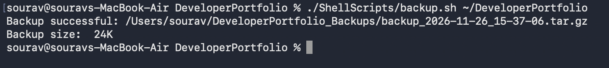

# Sourav — Developer Portfolio

> B.Tech Student | 1stSemester | Aspiring Software Developer

---

## Repository Index

| Repository                                                               | Description                             | Tech Stack        | Status |
| ------------------------------------------------------------------------ | --------------------------------------- | ----------------- | ------ |
| [cse103-lab-LAB3](https://github.com/sourav8282/cse103-lab-LAB3)         | CSE103 lab — Git, APIs, Shell scripting | Git, Python, Bash | Active |
| [developer-portfolio](https://github.com/sourav8282/developer-portfolio) | Personal portfolio index                | Markdown          | Active |

---

## Current Skills

- Python
- Linux / Bash
- Git / GitHub
- Markdown

---

## Learning Roadmap

- Improve Python programming
- Learn Data Structures and Algorithms
- Practice Linux and Shell scripting
- Build real-world projects
- Learn Web Development

---

## Current Goals

- Complete CSE103 Lab assignments
- Build a strong GitHub portfolio
- Improve programming skills
- Prepare for internships

---

## Screenshots

### GitHub Profile

### LinkedIn Profile

### Backup Script Demo

