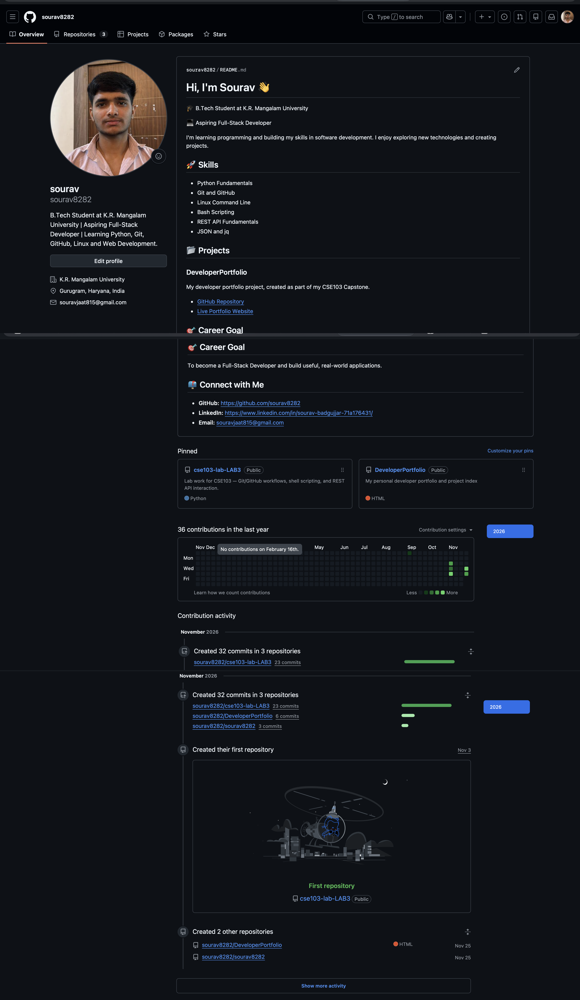
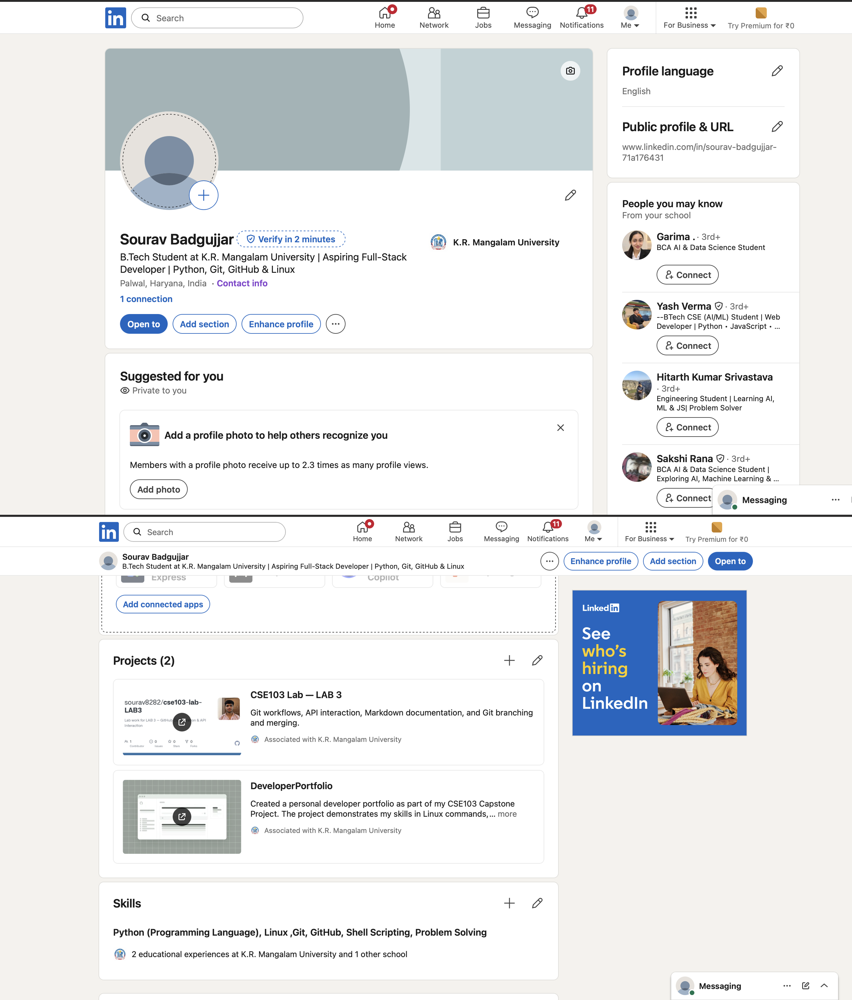

# Sourav — Developer Portfolio

**B.Tech Student | K.R. Mangalam University**

## Student Information

- **Name:** Sourav
- **Roll Number:** 2601730345
- **Section:** G
- **Programme:** B.Tech – Computer Science & Engineering

## Repository Information

- **Repository Name:** DeveloperPortfolio
- **Repository URL:** https://github.com/sourav8282/DeveloperPortfolio

## Professional Profiles

- **GitHub Profile:** https://github.com/sourav8282
- **LinkedIn Profile:** https://www.linkedin.com/in/sourav-badgujjar-71a176431/
- **Portfolio Website:** https://sourav8282.github.io/DeveloperPortfolio/

## Project Structure

- `Linux/` — System profile and command outputs
- `ShellScripts/` — System information and backup scripts
- `API/` — API data and documentation
- `Portfolio/` — Resume and learning roadmap
- `Screenshots/` — Project screenshots
- `index.html` — Personal portfolio website

## Skills

- Python Fundamentals
- Linux Commands
- Bash Scripting
- Git and GitHub
- REST APIs
- JSON and jq
- HTML and CSS Fundamentals

## Learning Roadmap

My career goal is to become a Full-Stack Developer.

- Improve Python programming
- Learn Data Structures and Algorithms
- Learn HTML, CSS and JavaScript
- Learn React and Node.js
- Work with databases and REST APIs
- Build real-world projects

## Project Screenshots

### GitHub Profile

### LinkedIn Profile

### Backup Script Demonstration

## Conclusion

This repository contains my CSE103 capstone project work, including Linux documentation, shell scripts, API interaction and my personal developer portfolio.
